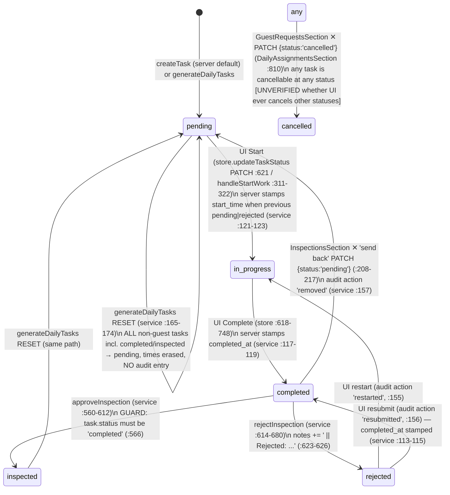
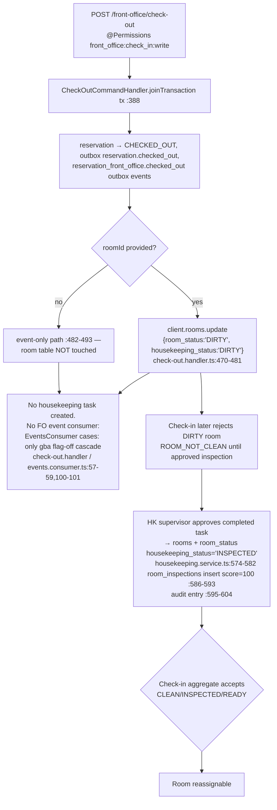
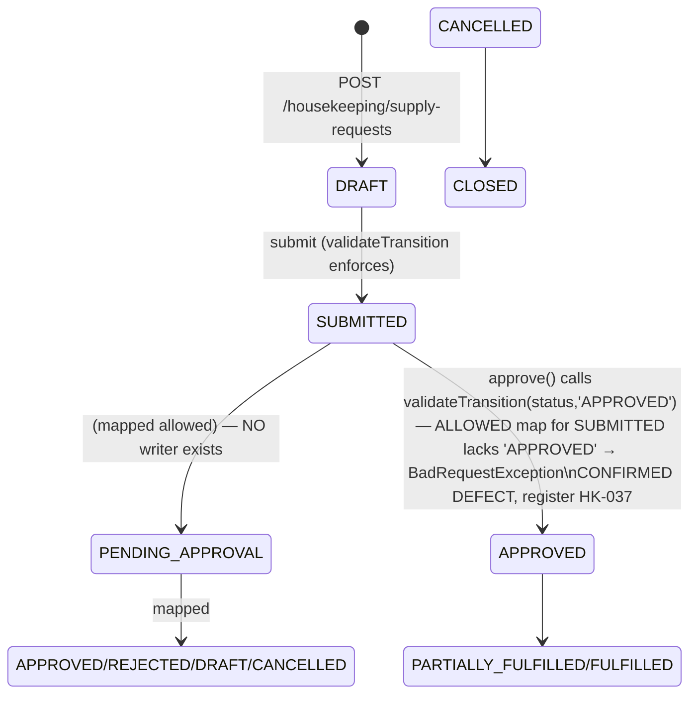

# XYLO HOUSEKEEPING — CURRENT-STATE WORKFLOW MAPS (DELIVERABLE 3)

Document: 03_WORKFLOW_MAPS.md
Lifecycle step: Phase 1 — Forensic Audit
Status: COMPLETE
Date: 2026-10-20
Scope: workflows as implemented today. Unverified branches are labeled **[UNVERIFIED]**. No target workflows are designed here.

---

## 1. Housekeeping task lifecycle (as enforced by `housekeeping.service.ts` + UI)

The backend accepts ANY status value on `updateTask`/PATCH (`:99`; `controller:51–59`) — the diagram below is the set of transitions **actually observed in code**, not an enforced machine.



Notes:
- "Guest:"-marked tasks are created **only** by the frontend (§3) and excluded from the reset filter (`service:166–172`).
- Room-condition side effects occur ONLY on approval (→ `rooms.housekeeping_status='INSPECTED'` + mirror, `:574–582`). No other transition touches room state (HK-006).
- No transition matrix is enforced server-side; supply-request service maintains its own real matrix (`housekeeping-supply-request.service.ts:6–49`) (HK-026).

## 2. Daily generation & assignment lifecycle (manual endpoint; no scheduler)

```mermaid
flowchart TD
    A[User clicks Generate Daily Tasks\nDailyAssignmentsSection handleGenerate :359-369] --> B[POST /housekeeping/tasks/generate-daily]
    B --> C[Rollover reset:\nupdateMany all non-Guest tasks → pending,\nstart_time/completed_at erased, no audit log]
    C --> D[hk_room_assignments rows fetched\nattendant rows only, type != 'supervisor' :214]
    D --> E{For each room in row.rooms JSON}
    E --> F{Task already exists for\nroom regardless of date?}
    F -- yes --> G[skip — no new task ever]
    F -- no --> H[create Full Clean task\npriority normal, assigned_to assignment.attendant_id,\nnotes 'Assigned to ATTENDANT NAME',\nTASK-Date.now() business id HK-005/HK-009]
    H --> E
    G --> E
    E --> I[Store refetches /housekeeping/tasks]
```

- **Trigger:** manual button only. Verified by cron sweep (all `@Cron` in `apps/api` enumerated: outbox×3, availability reconciliation, GBA wash/reconciliation — none housekeeping), Temporal workflows index is `export {}` (`apps/api/src/infrastructure/temporal/workflows/index.ts`), and no event fires generation (checkout track §3–6).
- **Staff allocation:** attendant rows in `hk_room_assignments` (`rooms` JSON array of room numbers). Supervisors are separate rows (`type='supervisor'`) whose `rooms` array holds **attendant ids** (HK-011). Assignment CRUD is live (`:258–276` + UI modal `DailyAssignmentsSection:845–931`).
- **Workload/capacity:** none server-side; UI bar uses hardcoded `DEFAULT_STAFF_CAPACITY = 25` (`DailyAssignmentsSection.tsx:49`). The credits system appears only in dead `TaskSheetsSection` + hardcoded `SettingsSection` credit table.
- **Shifts / business rules:** none — no day/night model, no business date. (Q-item HK-031/HK-036.)
- **Assignment reassignment:** `PUT /housekeeping/room-assignments/:id` propagates to future generations only, NOT to existing tasks (HK-004 — tasks keep their creation-time `assigned_to`).

## 3. Guest request → HK task flow (frontend-orchestrated)

```mermaid
flowchart TD
    A[Room-service request\nGET /room-service/requests?department=Housekeeping\nevery poll-free reload] --> B{status new/acknowledged?}
    B -- yes --> C[auto addTask POST /housekeeping/tasks\nnotes 'Guest: TYPE - note [requestId]'\nHK task id client-minted]
    C --> D[fire-and-forget PUT /room-service/requests/:id/assign\n .catch ignore]
    B -- manual --> E[Send to staff button\nmanual addTask + ack]
    C --> F[presence-task appears in DailyAssignments\nlinked by notes regex only — no FK]
    F --> G[Complete task → handleComplete\nPATCH task completed + PUT request complete\nfailure only console.error :324-342]
    F --> H[Cancel ✕ → PATCH task status='cancelled'] --> I[refetch tasks]
    G --> J[tasks NOT refetched (stale until reload)]
```

- Dedupe: in-memory `autoTaskIds` Set that resets on remount; second-pass dedupe checks exact room+staff match (`DailyAssignmentsSection :157–191`) — duplicate task creation on revisit is possible (**[UNVERIFIED at runtime]**, frontend track §4/§12).
- Requests are shown only in `GuestRequestsSection`; the store's `frontDeskRequests/unreadRequests` actions are dead (HK-022).

## 4. Checkout → Housekeeping flow (the actual implemented path)



Key verified properties:
- The ONLY product path that marks rooms un-hk-ready is checkout `HANDLER:471`; the only path that restores readiness is HK inspection approval (`:574–582`). **No "cleaned" stage exists** (HK-006/HK-014).
- `reservations.checked_out` event consumer exists but is flag-off GBA cascade only (`events.consumer.ts:57–59,194–203`; `compose.yaml:22` default OFF). `front_office.checked_out` (checked-out room published inside tx) has **no consumer** (default warn).
- `roomId` is the linchpin: `CheckOutDTO.roomNumber` (`front-office/dto.ts:71–85`) is never read by the handler; a checkout call carrying only `roomNumber` leaves the room CLEAN [OBSERVED BEHAVIOR], `check-out.handler.ts:451–455,470` — the handler's room lookup (`room.repository.ts:51–56`) uses `data.roomId` as room_number-or-id.
- Contrast paths: scheduled room moves write `room_status='DIRTY'` on the vacated room but never touch `housekeeping_status` (`execute-scheduled-room-move.handler.ts` per reservations tests `scheduled-room-moves.spec.ts`); transfer-room creates FO `housekeeping_traces` rows (department='Housekeeping') — no HK task.

## 5. Inspection & room readiness flow

```mermaid
flowchart TD
    A[GET /housekeeping/inspections/pending\nderived: tasks with status 'completed' AND notes not contains 'Guest:' :505-513] --> B[grouped by supervisor via\nhk_room_assignments supervisor rows' rooms=attendant ids :534-555]
    B --> C[Approve modal — inspectorId/Name hard-coded '' :342,365]
    C --> D[POST approve :285-293]
    D --> E[task → 'inspected' + completed_at=now]
    E --> F["raw UPDATE rooms + room_status\nhousekeeping_status='INSPECTED'"]
    E --> G[room_inspections INSERT passed_yn='Y' score=100]
    E --> H[audit log approved PENDING_INSPECTION→APPROVED\nperformedBy='' HK-008]
    D --> X[refetch pendingInspections + tasks + auditLogs only\nhistory list NOT refetched HK-033]
    C2[Reject modal — reason mandatory] --> Y[POST reject :290-294]
    Y --> Z[task → 'rejected' + notes rewrite + completed_at=null\nmessage_log INSERT w/ guest_id=attendant id :649-659\naudit rejected]
    Z --> R[attendant sees rejected task in task list,\nrestarts → in-progress 'restarted']
    Q[✕ send-back PATCH status=pending
   audit action 'removed'] --> R
    U[reassign endpoint POST inspections/:id/reassign]\nno UI caller HK-032] -.->|writes supervisor id into assigned_to| Z
```

- Inspection guards: only `status==='completed'` tasks are approvable/rejectable (`:566,620`).
- After any approve/reject, room-side INSPECTED/DIRTY persists; rejected tasks never set the room back to anything (room stays DIRTY — correct per gate, but no history entry at room level; `room_status_history` has no writer, HK-041 in 04 map).
- The "inspection readiness order" settings (`hk_status_flow_config`, `room_status_config`) are stored/read for the settings UI only; they do not drive gate logic (HK-014/HK-026 of the data map).

## 6. Linen & laundry sub-flows (persistence-free)

```mermaid
flowchart TD
    A[LinenSection UI] --> B[GET linen/types + linen/locations + linen/dashboard ✓ real reads]
    A --> C[GET linen/movements, room-configs, damaged, lost ✗ 404 (HK-001)]
    B --> D[synthesized reads: location splits 60/25/10/5, SKU mapping, id synthesis service :408-494]
    A --> E[ALL writes ✗ 404: types/locations/movements/configs/damaged/lost/transactions/stock/laundry CRUD]
    F[updateTaskStatus on task — store generates fabricated LinenMovements\nlocally (HK-002)] -.-> A
    G[linen_inventory real table: written only by CLI seed.linen\nno product write path since 404s] -.-> D
```

Consequence: the Linen & Laundry tab is a per-session sandbox — reads come from synthesized server projections, writes vanish on reload. Room linen configs used by the movement synthesis fall back to hardcoded `DEFAULTS` (store `:637–695`).

## 7. Person discrepancy flows (two parallel systems)

```mermaid
flowchart TD
    subgraph FO implemented
      A1[GET /front-office/discrepancies\n@Permissions front_office:check_in:read] --> A2[recompute: PHANTOM/UNRECORDED/HK_STATE_MISMATCH\nfront-office/get-discrepancies.handler.ts:37-101]
      A3[POST /front-office/discrepancies/:id/resolve\n@Permissions front_office:check_in:write] --> A4[room_discrepancies resolve]
    end
    subgraph HK broken/orphaned
      B1[PUT /housekeeping/rooms/:roomNumber/person-count\nexpects hkPersonCount] --> B2[RecordHKPersonCountCommand\nFO count = SUM adults+children of CHECKED_IN reservations :64-74]
      B3[frontend sends { personCount } ✗ mismatch] -.-> B1
      B2 --> B4[upsert person_discrepancies\nTABLE DOES NOT EXIST (ratified defect declaration)\nroom_number unvalidated]
      B5[events person_discrepancy_detected/resolved\nto outbox, NO consumer]
    end
    A2 -.->|separate store & semantics| B4
```

- FO side is live (used by FO discrepancy tile) and permission-gated; HK side is the only CQRS implementation in the module and is unreachable end-to-end (HK-003).
- `person_discrepancies` in the live DB per repository's own declaration — code path would fail with a relation error.

## 8. Supply-request flow (backend-only orphan)



Status machine, version bump, status_history, and audit ARE enforced here (contrast, HK-026), but:
- `approve()` from the only reachable submitting state is rejected by its own transition map → approval is dead (`housekeeping-supply-request.service.ts:7,379–405`; VERIFIED reading of VALID_TRANSITIONS + validateTransition).
- No frontend consumer exists in `apps/web` for `/housekeeping/supply-requests` (the inventory module's separate `/supply-requests` service is used by `apps/web/lib/inventory/...` instead) — the HK stack is backend-orphaned.
- Item-level operations (add/update/remove) are gated to DRAFT-only writes (`:328,457,520`).

## 9. Error, cancellation, unresolved-work paths (cross-cutting)

- **Server-side failures:** unhandled exceptions surface as raw Nest 500s on `createTask` collisions; `catch(()=>{})` swallows on room-status writes (#`approve`): `approveInspection` swallows SQL failures of both the mirror and the `room_inspections` inserts (`.catch(() => {})`, `:574–593`) — an approval can report success with zero room state changed and no inspection-row row. Recorded as UNVERIFIED-at-runtime; code-level swallowing is VERIFIED.
- **Reject notification** failure is logged, non-blocking (`:657–659`).
- **Client-side:** only `DailyAssignmentsSection` surfaces the store `error` ("Retry"); everything else swallows it (per frontend track §5). Failures leave prior state (no rollback), with fabricated linen movements already applied (HK-002).
- **Unresolved work:** there is no "handover" mechanism; rollover resets `pending` (HK-004); rejected tasks that follow generate-reset also go back to `pending` (status overwritten; notes rejections remain).
- **Cancellation:** only source in live UI is GuestRequests ✕ on the guest-request task; the backend accepts cancellation on any task via API (HK-026).
