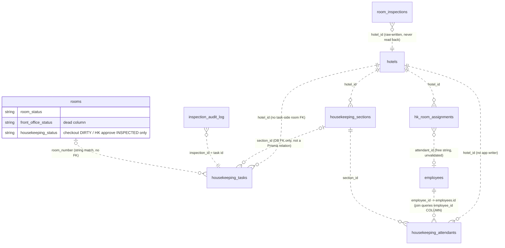

# XYLO HOUSEKEEPING — CURRENT-STATE DOMAIN AND DATA MAP (DELIVERABLE 4)

Document: 04_DOMAIN_AND_DATA_MAP.md
Lifecycle step: Phase 1 — Forensic Audit
Status: COMPLETE
Date: 2026-10-20
Purpose: Document the existing domain entities, relationships, status fields, assignment ownership, and API/event boundaries as they ARE today. No target-state schema is proposed here.

Evidence labels: **VERIFIED FACT** (confirmed in repository/schema/migrations/ratified declarations) · **OBSERVED BEHAVIOR** (code path as written; source-inspected only) · **UNVERIFIED / OPEN**.

---

## 1. Prisma model inventory (housekeeping-relevant)

Source of truth: `packages/db/schema.prisma` (working tree). `packages/db/inventory.prisma` contains zero housekeeping content. There is **no Prisma enum anywhere in the schema** — every status/priority column is free-form `String` (VERIFIED FACT).

### 1.1 Core task & assignment models

**`housekeeping_tasks`** — `schema.prisma:5759–5779`

| Field | Type / default | Notes |
|---|---|---|
| `id` | String @id | PK. **Server accepts and persists client-minted ids** (`data.id \|\| HK-${Date.now()}`, `housekeeping.service.ts:59`) |
| `hotel_id` | String | FK → hotels (`fk_housekeeping_tasks_hotel_id`) |
| `task_id` | String | Business id. `@@unique([hotel_id, task_id])` (5776). Generated `TASK-${Date.now()}` per create (service:191) |
| `room_number` | String | Free text. **No FK to `rooms`** (room existence never validated on write) |
| `section_id` | String | FK to housekeeping_sections exists in DB (`fk_housekeeping_tasks_section_id` — evidenced by createTask fallback catch, service:74-78); NOT declared as a Prisma relation in schema.prisma |
| `task_type` | String | Runtime values: `'Full Clean'` (default), `'LINEN'` (linen queries service:373), `'Checkout Clean'` only as SLA metadata (service:927) |
| `priority` | String @default("normal") | Free string; runtime values `normal` / store typing `low|medium|high|urgent` conflict with shared `TASK_PRIORITY LOW/MEDIUM/HIGH/URGENT` |
| `status` | String @default("pending") | Runtime vocabulary (lowercase): `pending, in-progress, completed, inspected, rejected, cancelled` |
| `assigned_to` | String? | Staff reference as free string; **no FK, no membership validation** (any `staffId` string accepted — `updateTask` service:100) |
| `start_time` / `completed_at` | Timestamptz? | Written on transition heuristics (service:104-123) |
| `notes` | String? | **Doubles as a data protocol field**: `Assigned to {name}` (generation, service:198), `Rejected: {reason}` (rejection, service:624), `Guest:` marker (guest requests — parsed by regex in UI and filtered in queries service:166-172, 505-513) |
| `created_at` / `updated_at` | Timestamptz | |

**There is NO business_date / task_date column** (VERIFIED FACT, full model read). "Daily" semantics are simulated by `generateDailyTasks()` status-reset logic (§4).

**`hk_room_assignments`** — `schema.prisma:5781–5794`

- PK `id` (String; server persists client-minted `RA-…`/`SUP-…` ids, service:223, 846)
- `attendant_id` String, `attendant_name` VarChar(200) — denormalized name copy
- `type` VarChar(30): observed values `room | corridor | restaurant | banquet | public-area | lobby` (UI type union, store:348) **plus `supervisor`** (filter value service:214, 502, 837) — supervisor rows live in the same table
- **`rooms` Json @default("[]")** (5787) — for attendant rows: array of room-number strings; **for supervisor rows: array of ATTENDANT ids** (getPendingInspection treats `sa.rooms` as attendant ids, service:539-541). One column, two meanings (VERIFIED FACT).
- `area_name`, `created_at`, `updated_at`. `@@index([hotel_id, attendant_id])`.
- **No hotel/property binding to a date, shift, or schedule** — assignments are timeless (no business_date column).

**`housekeeping_attendants`** — `schema.prisma:5699–5714`

- `hotel_id` + `employee_id` unique (5712). `employee_id` FK → `employees.id` **(the UUID PK)**, confirmed in DB DDL: `20261002000000_c03_late_reconciliation/migration.sql:1393` references `employees(id)` — while `HousekeepingService.getStaff()` (service:290-298) filters `employees.employee_id` (the business code column, separate field per `schema.prisma:3505`) against those UUIDs. Join compatibility depends on runtime data equality; no in-repo seed populates `housekeeping_attendants` to compensate (tests track, §5.4 of 05).
- `status` @default("active"), `assignments Int`, `section_id` FK.
- **No writer anywhere in the codebase** — the only reference is the read in `getStaff()` (`grep housekeeping_attendants` in `apps/api`: 1 hit). HK staff onboarding is NOT implemented.

**`housekeeping_sections`** — `schema.prisma:5737–5755` — self-relation `section_id → id`, unique `[hotel_id, section_id]`. Read by `getSections()` (service:327-335). No writer in HK module; created only via migrations/manual DB.

### 1.2 Room state models

**`rooms`** — `schema.prisma:11174–11205`
- `room_status String @default("AVAILABLE")` (11179) — single column carrying occupancy **and** condition values (`OCCUPIED, VACANT, AVAILABLE, ASSIGNED, DIRTY, OUT_OF_ORDER, OOO`)
- `front_office_status String @default("CLEAN")` (11180) — **no production writer exists** (grep; corroborated by `docs/front-office/PHASE_3_IMPLEMENTATION_REPORT.md:292,354`)
- `housekeeping_status String @default("READY")` (11181) — **two production writers** in the whole API: checkout `DIRTY` (`check-out.handler.ts:471`) and HK inspection approval `INSPECTED` (`housekeeping.service.ts:575`)
- No DB unique on `room_number`; composite availability index `idx_rooms_status_availability ([hotel_id, room_status, front_office_status])` — `housekeeping_status` is NOT indexed.

**`room_status`** (legacy mirror table) — `schema.prisma:10959–10971`
- Composite PK `[room_number, hotel_id]`; nullable `housekeeping_status` (no default — diverges from `rooms` 'READY'); `front_office_status`, `dnd_status`, `last_updated`
- Only production writer: HK inspection approval `INSPECTED` (`housekeeping.service.ts:580`). Checkout does NOT mirror `DIRTY` into it. No systematic readers found in app code.

**`room_status_history`** — `schema.prisma:10992–11006` — id, room_number, status, changed_at, changed_by, reason. Single repo reader: `front-office/application/queries/get-room-detail.query.handler.ts:72–75`. **No writer exists anywhere in the monorepo** (grep verified, incl. migrations) → the FO "Housekeeping changed" block always gets NULL.

**`room_status_config`** — `schema.prisma:10976–10988` — `inspected_first / clean_second / pickup_third / dirty_fourth` Char(1) flags. **Zero readers** in app code. Encodes an intended canonical inspection order that is dead.

**`room_inspections`** — `schema.prisma:10509–10521` — score/passed_yn log written only by raw SQL in approve/reject (`housekeeping.service.ts:586-593, 639-646`). Score hardcoded 100 on approve, 0 on reject. Parallel legacy model `housekeeping_inspection` (`@@ignore`, 5720–5733).

**`room_maintenance`** — `schema.prisma:10546–10562` — id, room_number, maintenance_type, status @default("pending"), requested_by, completed_by. **No HK integration**: no housekeeping code creates or consumes maintenance rows; no OOO/OOS room-status writer ties to it.

**`room_turndown` / `turndown_items`** — `schema.prisma:11011–11025` — turndown data lives here (per room, service_date), not in room status. No writer surfaced from the HK module (FO/billing flows own it).

### 1.3 Linen models

**`linen_inventory`** — `schema.prisma:6486–6500` — linen_type/category/department/unit_cost/quantity_on_hand/par_level per hotel. Seeded only by `packages/cli/src/commands/db/seed.linen.ts` (deleteMany + createMany, 285–286).
- **Read surfaces are synthesized**: `getLinenStocks()` (service:459–494) splits real stock into fake locations at fixed 60/25/10/5 % ratios; `getLinenTypes()` (408–457) re-maps to hardcoded SKUs; `getLinenDashboard()` aggregates the real table.
- `getLinenStatus()` (369–385) counts **task rows** with `task_type='LINEN'` as "linen status" — no linen table involvement.

**`linen_usage`** — `schema.prisma:6504–6515` — no HK module writer/read surfaced.

The frontend linen feature (types, locations, movements, room-configs, damaged, lost, laundry batches) has **no backend persistence at all** — all of its endpoints are missing (02 register HK-001).

### 1.4 Discrepancy models — two parallel, incompatible implementations

| | FO side (implemented) | HK side (CQRS, broken/orphaned) |
|---|---|---|
| Table | `room_discrepancies` (raw-SQL only, absent from schema.prisma) with business_date, discrepancy_type, **hk_status fed from `rooms.front_office_status`** (`get-discrepancies.handler.ts:60,70`) | `person_discrepancies` — **never created**; formally declared known defect (`packages/db/migration-baseline.declarations.json:89–99`, `code-referenced-never-created`, `acceptedKnownDefect: true`) |
| Producer | `GetDiscrepanciesHandler` recomputes PHANTOM_OCCUPANCY / UNRECORDED_OCCUPANCY / HK_STATE_MISMATCH each call (`front-office/application/queries/get-discrepancies.handler.ts:37–101`) | `RecordHKPersonCountHandler` upserts FO guest count vs HK person count (`record-hk-person-count.handler.ts:26–74`) — room_number unvalidated |
| API | `GET /front-office/discrepancies` + resolve, permission-gated (`front-office.controller.ts:50,60` `@Permissions('front_office:check_in:*')`) | `PUT /housekeeping/rooms/:roomNumber/person-count`, `POST .../resolve`, bulk, `GET /housekeeping/mobile/discrepancies` — no permission metadata |
| Events | none pooled | `housekeeping.person_discrepancy_detected/resolved` (events/housekeeping.events.ts) — published to outbox, **no consumer anywhere** (EventsConsumer default-warn; grep `@OnEvent` = 0 hits repo-wide) |
| Frontend | FO discrepancy tile (live) | `features/housekeeping` React Query feature — **zero render sites** (grep: no consumer of `PersonDiscrepancyPanel` / `MobilePersonDiscrepancyList`), plus payload mismatches (`personCount` vs `hkPersonCount`; resolve without `action`) |

### 1.5 Audit & config stores

- **`inspection_audit_log`** — `housekeeping.service.ts:11–36` runtime `CREATE TABLE IF NOT EXISTS` (also present in migrations: `20250101000000_c03_core_baseline_capture:7699`, `20260726000000_phase0b_baseline:861`; schema.prisma:13726). All task-status changes, approvals, rejections, reassignments are logged with from/to status + actor-from-body. **Runtime DDL in a service is a standing schema-governance divergence** even though the table also exists in the migration chain.
- **`property_config`** KV — `hk_sla_config` and `hk_status_flow_config` persisted via `getConfig/setConfig` (service:880–953) with a **process-local in-memory cache Map** (never invalidated; per-instance divergence risk) and **write failures swallowed** (`setConfig` catch → still returns success payload).
- **`housekeeping_supply_request_*`** family — `schema.prisma:16225–16410` (requests, items, approvals, deliveries, attachments, comments, status_history, audit_logs) + runtime sequence `hk_supply_request_seq` (`housekeeping-supply-request.service.ts:28`). Full status machine implemented server-side (DRAFT→SUBMITTED→…→CLOSED) — see the supply-request flow findings in 02_FINDINGS_REGISTER.md (03_WORKFLOW_MAPS.md §8) for the broken approve edge.
- **`housekeeping_traces`** — `schema.prisma:13652` — written by **Front Office** on room transfer (`transfer-room` → `createTrace department:'Housekeeping'`, per test `transfer-room.handler.spec.ts:61–79`), read by FO traces UI. HK module itself does not own it (`front-office/__tests__/d10-dead-table-redirect.spec.ts` pins `housekeeping_traces` as the live store). **Cross-module boundary exception: traces live outside the HK module but semantically belong to it.**

### 1.6 Absent models (with ratified evidence)

| Missing | Evidence |
|---|---|
| `person_discrepancies` table | `migration-baseline.declarations.json:90–99` — accepted defect |
| Business-date column on tasks | Full model read 5759–5779 (no such field) |
| Staff-membership FK on `assigned_to` | Full model read 5768 (plain String) |
| Employee link for HK supervision | FO aggregate treats supervision as room_status/occupancy concern; HK module orphans it |
| `laundry_batches` Prisma model / any laundry table | grep of migrations for laundry DDL: none surfaced (see 05) |

## 2. Ownership map (who owns what state today)

| State | Owner module | Writers | Readers |
|---|---|---|---|
| `rooms.housekeeping_status` | **Front Office (DIRTY at checkout) + Housekeeping (INSPECTED at approval)** | `check-out.handler.ts:471`; `housekeeping.service.ts:575` | FO check-in aggregate gate (`room.aggregate.ts:30,90-98`), scheduled room moves (`execute-scheduled-room-move.handler.ts:61–68`), HK room list, discrepancy read-set, HK mobile endpoint |
| `rooms.room_status` | Front Office (assignment lifecycle), Housekeeping (none) | assign/occupy/release aggregate, transfer/upgrade handlers | Reservations F-25 sellability (`room_status='AVAILABLE'`, `prisma-inventory-reservation.adapter.ts:33–39`), availability, rack, engineering |
| `rooms.front_office_status` | nobody (dead) | — (default 'CLEAN') | OUT_OF_SERVICE gate (`room.aggregate.ts:36`), assignment service (:88,:132) |
| `room_status.housekeeping_status` (mirror) | Housekeeping (INSPECTED only) | `housekeeping.service.ts:580` | no app reader found |
| `housekeeping_tasks.status` | Housekeeping | generateDailyTasks (reset+create), createTask, updateTask, approve/reject/reassign | task UI, dashboard counts, pending-inspections derivation |
| `hk_room_assignments.rooms` | Housekeeping | room-assignments CRUD controller | generation of tasks, due-out sort, dashboard kanban synthesis, supervisor pending view |
| `inspection_audit_log` | Housekeeping | updateTask/approve/reject/reassign | InspectionsSection audit + history tabs |
| `room_inspections` | Housekeeping | approve/reject raw inserts | none read back |
| `housekeeping_traces` | Front Office (writes/reads) | transfer-room handler | FO traces inventory |
| `property_config` HK keys | Housekeeping | sla/status-flow config endpoints | SettingsSection only (display) |
| `linen_inventory` | CLI seed + unknown external processes | seed.linen.ts | synthesized HK GET endpoints |

## 3. API surface (contract inventory)

Controller: `apps/api/src/modules/housekeeping/housekeeping.controller.ts` — 62 routes under `@Controller('housekeeping')` + `@PropertyScope()` (`:19–20`). Full route list recorded in `05_VERIFICATION_AND_COVERAGE.md` §2 and the contract table in `02_FINDINGS_REGISTER.md` Annex A.

- Global prefix `/api/v1` (`main.ts:21`). Register guard: JWT (`JwtAuthGuard`), PropertyScopeGuard, MultiTenantGuard (`app.module.ts:108–115`).
- `front_office.controller.ts` adds `GET /front-office/discrepancies`, `POST /front-office/discrepancies/:id/resolve` (`:50,60`).
- `lost-found.controller.ts` — 37 routes (`:5–235`).
- `room-service.controller.ts` owns guest requests consumed by HK UI.
- Frontend base path: `apps/web/services/api.ts` → `/api` → Next rewrite to `NEXT_PUBLIC_API_URL` (default `http://localhost:4000/api/v1`). Alternate client `apps/web/lib/api/client.ts` defaults to `/api/v1` directly. Mobile client targets `/api/v1` (`apps/mobile/services/api/client.ts:4`) but makes **no** housekeeping calls.

## 4. "Daily" semantics as implemented

**VERIFIED FACT** — `generateDailyTasks()` (`housekeeping.service.ts:162–207`) is the ONLY way daily work appears; there is no scheduler, no cron, no Temporal workflow, no event (per checkout-track report §4–6):

1. Bulk `updateMany`: every task of the hotel whose notes do NOT contain `'Guest:'` (regardless of current status, including `inspected`/`completed`) is reset to `status:'pending'`, `start_time:null`, `completed_at:null` — **no audit entry is written for this reset**.
2. For each `hk_room_assignments` row × each listed room: if a task row already exists for that room (any status, any date) → skip; else create `Full Clean` task with `priority:'normal'` assigned to the row's `attendant_id`, notes `Assigned to {attendant_name}`.

Consequences (all code-verifiable): daily rollover is destructive history-wise; rooms with tasks never get new tasks on reassignment changes; `completed_at` of approved tasks is cleared; only one drawing of the plan exists until someone re-runs the manual endpoint.

## 5. Data-graph summary (Mermaid)

**Note:** relationships shown are de-facto (string matches / proven runtime joins), not enforced FKs — housekeeping_tasks has no FK to rooms, and hk_room_assignments carries entities as JSON string arrays.
