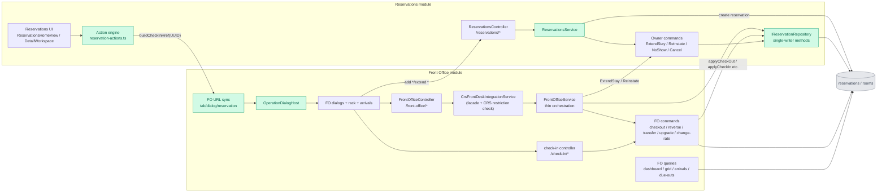
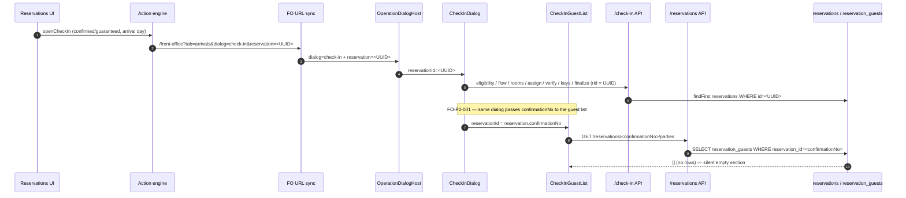
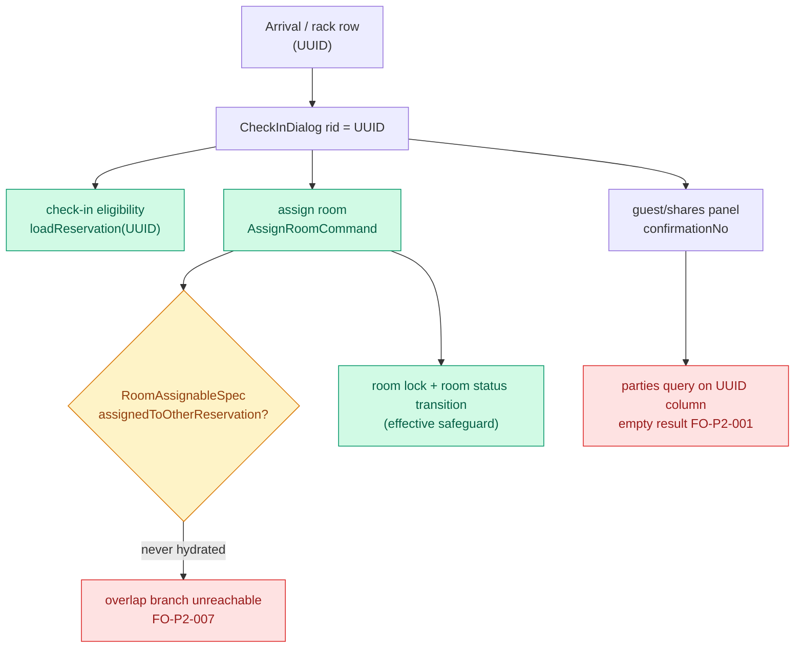
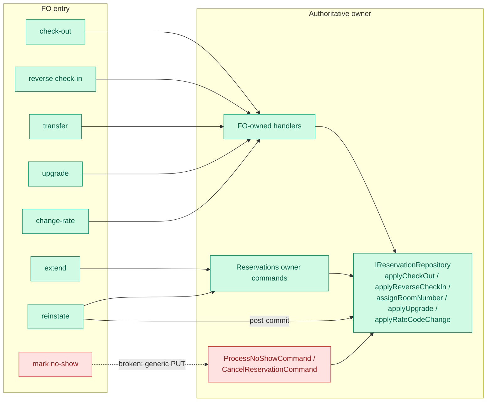
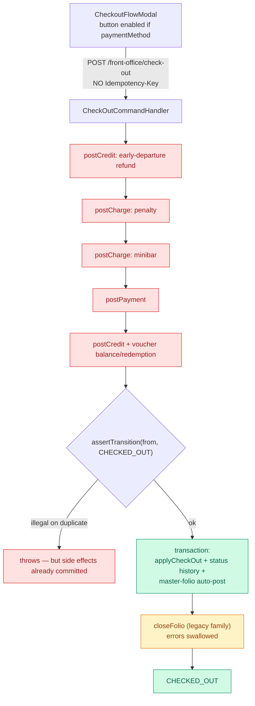
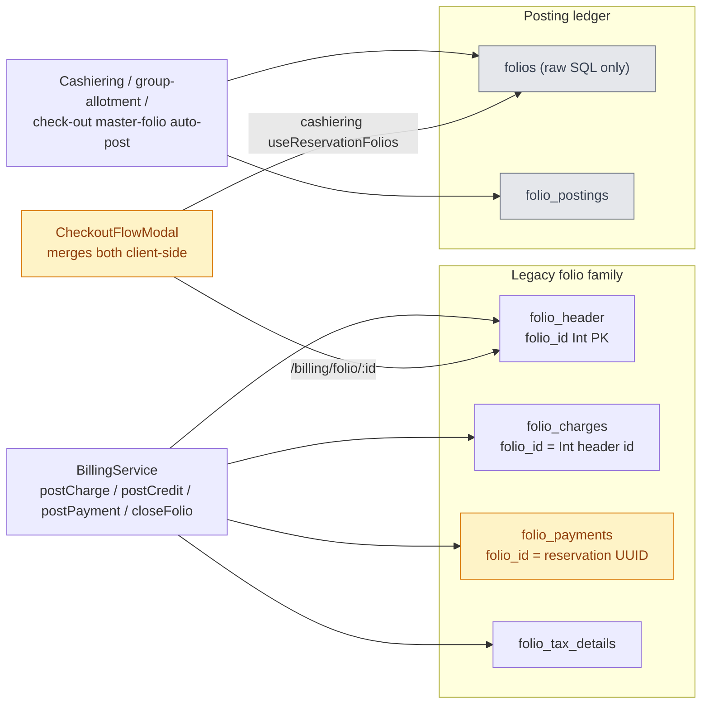
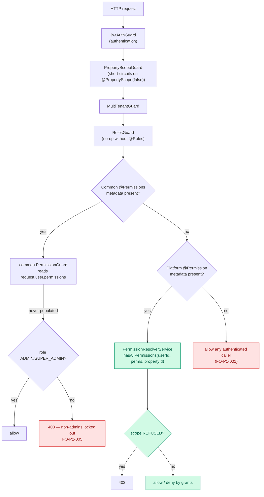
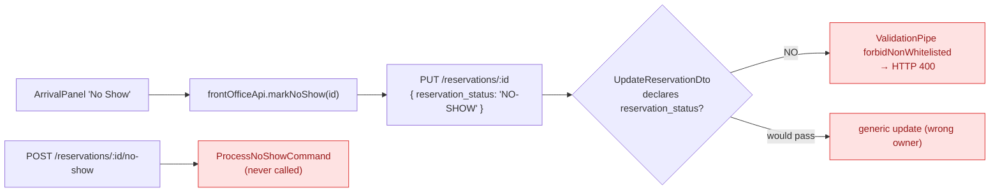
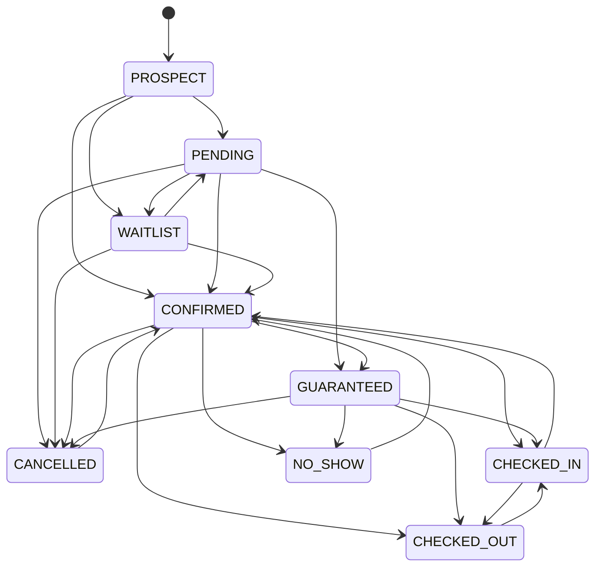

# XYLO Front Office — Phase 2: Reservation ↔ Front Office Integration Map

- **Date:** 2026-10-17
- **Phase:** Phase 2 — Reservations ↔ Front Office Integration Audit (audit-only)
- **Companion documents:** `docs/front-office/PHASE_2_RESERVATIONS_INTEGRATION_AUDIT.md`, `docs/front-office/PHASE_2_INTEGRATION_GAP_REGISTER.md`, `docs/front-office/PHASE_2_BASELINE_AND_EXIT_GATE.md`

## Legend

| Style | Meaning |
|---|---|
| Green | Verified / working integration seam (direct source and/or test) |
| Red | Confirmed integration defect (`FO-P2-*`) |
| Amber | Suspected / partially verified / not runtime-executed |
| Grey | External module or data store (not fully traced here) |

All diagrams describe the **working tree** at `HEAD = ed278bc`. They are descriptive, not prescriptive.

---

## 1. Overview — Reservations ↔ Front Office Seams

**Notes**
- The facade `CrsFrontDeskIntegrationService` (`crs-front-desk-integration.service.ts:14-20`) sits between the controller and `FrontOfficeService`; it is pass-through except for a CRS restriction check on `changeRateCode` (`:97-115`).
- `FO-P2-002` and `FO-P2-009` are the two seams where the UI reaches the Reservations API with the wrong contract/vocabulary.

---

## 2. Check-in Hand-off and Staged Flow (confirmed, with one defect branch)

**Confirmed:** the staged-flow calls use the UUID (`CheckInDialog.tsx:205,252,266,285,298,312`; `check-in-workflow.service.ts:39-46`).
**Defect:** the guest/shares panel uses `confirmationNo` (`CheckInDialog.tsx:556`; `CheckInGuestList.tsx:73`; `reservation.repository.ts:1458-1463`).

---

## 3. Lifecycle Ownership — Who Writes What

**Verified by test (direct + test-derived):**
- `ExtendStayCommand` payload mapping and `ReinstateReservationCommand` dispatch, with reinstate room write through `assignRoomNumber` and *no* `prisma.reservations.update` — `apps/api/src/modules/front-office/__tests__/command-ownership.spec.ts` (PASS, 8 tests).
- `@Permission` enforcement on reinstate/transfer/extend/upgrade/change-rate, including property-scope `REFUSED` — `fo-route-permissions.spec.ts` (PASS, 17 tests).

**Defect:** no-show does not use `ProcessNoShowCommand` (`FO-P2-002`).

---

## 4. Check-out — Financial Side Effects vs. Status Transition

**Confirmed defect:** the pre-transition side effects are outside the idempotency/transition protections (`FO-P2-003`). The status write itself is protected (`CHECKED_OUT → CHECKED_OUT` is illegal — `reservation-state-machine.ts:39`).

**Suspected / policy-dependent:** no server-side settlement assertion before `closeFolio` (`FO-P2-008`).

**Potential risk (`FO-P2-006`):** keys collide across families and within the legacy family (`folio_header.folio_id` Int vs `folio_payments.folio_id` UUID); no server-authoritative merged balance was found.

---

## 5. Authorization Enforcement

**Confirmed:**
- Guard order/registration: `app.module.ts:107-109` (JWT, property scope, multi-tenant) + `common/authorization/authorization.module.ts:18-22` (roles, common permission, resource access).
- `request.user.permissions` is not hydrated (`auth.service.ts:129-140`), so the common `@Permissions` guard (§9.2) is effectively admin-only (`FO-P2-005`).
- The platform `@Permission` guard works and enforces scope (test-derived, `fo-route-permissions.spec.ts` PASS).
- Routes with neither decorator remain open to any authenticated caller (`FO-P1-001`).

---

## 6. No-Show Seam (defect)

---

## 7. Status Vocabulary (shared, confirmed)

Source: `packages/shared/src/reservation-state-machine.ts:32-42`; enforcement: `reservations/domain/services/reservation-status.service.ts:30-36`.

---

## 8. Coverage of the Map

| Seam | Status |
|---|---|
| Reservations → FO check-in deep link | Confirmed (source + E2E test exists, not executed) |
| Check-in staged flow identifier | Confirmed UUID |
| Check-in guest/shares identifier | Defect (`FO-P2-001`) |
| FO → Reservations extend / reinstate | Confirmed (test-derived) |
| FO → Reservations no-show | Defect (`FO-P2-002`) |
| Check-out status transition | Confirmed |
| Check-out financial ordering / idempotency | Defect (`FO-P2-003`) |
| Check-out settlement gate | Suspected (`FO-P2-008`) |
| Folio authority | Suspected / potential risk (`FO-P2-006`) |
| Room overlap safeguard | Unreachable (`FO-P2-007`) |
| Permission enforcement | Confirmed split + defect (`FO-P2-005`) |
| FE/BE permission vocabulary | Defect (`FO-P2-009`) |
| Realtime invalidation matrix | Partially verified (not exhaustive) |
| `apps/mobile` | Not scanned (carried from Phase 1) |

---

*End of Phase 2 integration map.*
